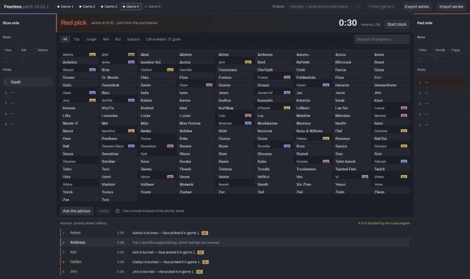

# Fearless

**A Fearless Draft organiser for League of Legends coaches that cannot propose an illegal pick.**

Cloud9 x JetBrains: Sky's The Limit 2026 · Category 2 (LoL macro scouting & draft management) · also entered for the JetBrains evidence bonus

**[Live demo](https://rizwankhalid675.github.io/fearless-cloud9-2026/)** — press *Load a demo series* · **Video:** _pending_ · **Limits:** [what this does not do](docs/LIMITS.md) · **Numbers:** [measured results](docs/RESULTS.md)



*Game 4 of 5. 136 available, 37 gone. The advisor proposed five champions; the rules engine
refused four of them and named the game that burned each one.*

---

## The problem

Fearless Draft bans every champion used in previous games of a series. By game 5 a coach is
tracking roughly 50 unavailable champions across five games, on a 30-second draft timer, and
the category brief names the artefact they do it with: a spreadsheet. The failure mode is not
losing the draft. It is calling a pick that is already burned, on stage, with the clock
running.

## The idea

**The model proposes. Deterministic code decides.**

A pure rules engine owns champion availability and is the only thing in the codebase allowed
to say whether a pick is permitted. An advisor suggests picks and bans with reasoning — and
every suggestion it makes passes through that engine before it can be rendered. An illegal
suggestion is not hidden. It is shown struck through, with the engine's reason and a chip for
the game that burned it.

On a measured run, **21 of 50 suggestions (42%)** from a realistic priority-sheet advisor were
illegal. The gate caught all of them.

## How it meets the judging criteria

| Criterion | Weight | How it is met | Where to see it |
|---|---:|---|---|
| Technological Implementation | 20% | Pure TypeScript rules engine, 102 tests, verified against hand-computed ground truth on 10 fixtures — 10/10 exact. Built in WebStorm with `.idea/` committed. | [`src/engine/fearless.ts`](src/engine/fearless.ts), [`docs/RESULTS.md`](docs/RESULTS.md) |
| Design | 20% | One screen, no scrolling during a draft, laid out the way coaches already read the game client. Type to search, Enter to lock. All 19 text styles verified against WCAG AA in the browser. | [`src/ui/`](src/ui/) |
| Potential Impact | 20% | Replaces the spreadsheet the category brief names, for a job where being wrong is public. Both Fearless rulesets supported, because leagues differ. | [`docs/LIMITS.md`](docs/LIMITS.md) |
| Quality of the Idea | 20% | Not "AI picks your draft". The interesting half is refusing the AI: a gate that keeps every illegal suggestion visible so the coach learns why it is gone. | [`src/advisor/gate.ts`](src/advisor/gate.ts) |
| Presentation | 20% | Video shows game 4 with 30 champions burned and the gate blocking 4 of 5 suggestions, end to end. | [`VIDEO.md`](VIDEO.md) |

Bonus prize (JetBrains evidence): [`docs/JETBRAINS.md`](docs/JETBRAINS.md).

## The measured numbers

| What | Result |
|---|---|
| Rules engine vs hand-computed ground truth | **10 / 10 fixtures exact** |
| Illegal suggestions caught by the gate | **21 of 50 (42%)** |
| Champion catalogue | 173 champions, Data Dragon patch 16.23.1, committed |
| Tests | **102**, no network, no API key |

Regenerate both with `npm run measure`. Numbers are written by that script, not by hand.

## Run it

```bash
npm install
npm test
npm run dev
```

Then press **Load a demo series** — three completed games, 30 champions burned, game 4
mid-draft. No API key and no network needed: the default advisor is offline.

## Architecture

```
                 ┌──────────────────┐
  advisor ──────▶│  gateSuggestions │──────▶ screen
  (proposes)     └────────┬─────────┘        (blocked ones shown,
                          │                   struck through, with
                 ┌────────▼─────────┐         the game that burned them)
                 │  rules engine    │
                 │  legalityOf()    │  ◀── the only authority on availability
                 └──────────────────┘
```

### Repo map

| File | Does |
|---|---|
| [`contracts.ts`](contracts.ts) | Every shared type. `Legality` is produced by the engine and by nothing else. |
| [`src/engine/fearless.ts`](src/engine/fearless.ts) | Derives the legal pool. Pure — no clock, no network, no React. |
| [`src/engine/draftOrder.ts`](src/engine/draftOrder.ts) | 20-slot tournament order; asks the engine, never re-derives legality. |
| [`src/engine/series.ts`](src/engine/series.ts) | Series state, and an import that reports every problem rather than throwing. |
| [`src/advisor/gate.ts`](src/advisor/gate.ts) | The only path from an advisor to the screen. |
| [`src/advisor/tier.ts`](src/advisor/tier.ts) | Offline advisor. Deliberately pool-blind — see below. |
| [`src/advisor/llm.ts`](src/advisor/llm.ts) | Optional model advisor. Deliberately unvalidated — see below. |

### Two deliberate decisions that look like bugs

**The default advisor does not know what is legal.** That is the point. It ranks champions by
a static priority tier, exactly as a coach's priority sheet does, and a priority sheet knows
nothing about what the series burned. So the offline demo shows the gate catching real
illegal suggestions, with no API key and no network — and the 42% is a measurement of the
status quo, not of a strawman.

**Neither advisor validates its own output.** If an advisor filtered itself, the gate would
stop being the thing that keeps the product honest, and the failure worth showing — a model
confidently naming a champion that is burned, or one that was never real — would be hidden
inside the advisor instead of shown on screen.

## Honest limits

Named in full in [`docs/LIMITS.md`](docs/LIMITS.md). The ones that would matter first:

- **Two Fearless variants are implemented, out of more that exist in the wild.** Leagues also
  burn bans, burn only from games a team won, or cap the burn at a number of games.
- **Champion roles are a convenience filter, not ground truth.** They are widened from Data
  Dragon `tags`, which classify a champion rather than place it.
- **The priority tiers are one person's opinion**, cover 50 champions, and reflect one view
  of patch 16.23. Everything unlisted is tier 4.
- **The champion snapshot is pinned to patch 16.23.1 and will age.** It is committed so the
  demo runs offline and a judge sees what the video shows; `npm run champions` refreshes it.
- **The model advisor is optional and unmeasured here.** `docs/RESULTS.md` leaves its rows
  absent rather than estimated, because no API key was set on the run that produced it.
- **No scouting data.** No win rates, no opponent tendencies, no GRID integration.

## Provenance

Newly created for this hackathon: the first commit of project code is dated 20 November 2026,
three days after the submission period opened. Nothing here predates the event.

## Licence

MIT — see [LICENSE](LICENSE).

Fearless is not endorsed by, sponsored by or affiliated with Riot Games. Champion names come
from Riot's Data Dragon, the static data Riot publishes for community tools. No Riot artwork
is used.
